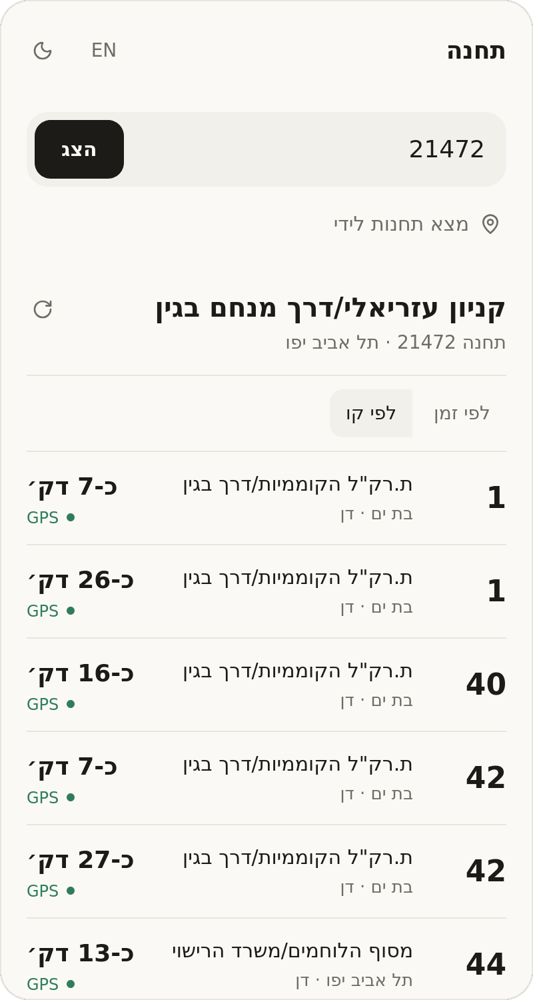

<div align="center">


<h1>Tachana</h1>

<p>
  <b>The screen your bus stop should have.</b><br>
  Live arrivals for any stop in Israel, in Hebrew and English.
</p>

<p><a href="https://tachana-live.pages.dev"><b>Open Tachana →</b></a></p>

<br>

<picture>
  <source media="(prefers-color-scheme: dark)" srcset=".github/assets/screen-dark.png">
  
</picture>

</div>

<br>

## Features

- Type a stop number, or find the stops around you
- See which arrivals have a recent GPS report and which are only a forecast
- Sort by line or by time, with updates every 30 seconds
- Light and dark themes
- Nothing to install and no account

Times are estimates, and a bus can pass without stopping, so signal the driver.

## Develop

```sh
pnpm install
pnpm dev
```

Pushing to `main` deploys to Cloudflare Pages, using the build command `pnpm build` and the output directory `dist/client`.

## Stack

React, TypeScript, Vite, Tailwind, and shadcn/ui on the front end. A [Hono](https://hono.dev) API runs on Cloudflare Pages Functions.

## Data

Arrivals come from [curlbus](https://curlbus.app), based on the Ministry of Transport's SIRI feed. Stop names come from [Open Bus](https://open-bus-stride-api.hasadna.org.il/docs) by The Public Knowledge Workshop.
